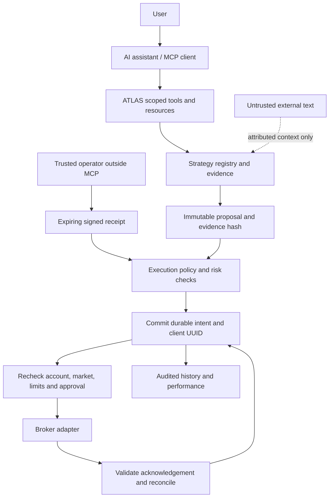

# ATLAS

**AI-assisted quantitative trading research engine.** Inspect evidence, compare strategies, simulate trades, and prepare immutable order proposals through MCP. Deterministic code owns portfolio truth, risk limits, approval verification and order recovery.

ATLAS includes an offline paper broker, a strategy registry, a durable execution journal, and restricted Robinhood adapter code. **It is a development platform, not a live-ready trading product.** The historical models do not yet have sufficient independently verified evidence to justify funded trading.

## Try it without an account

Requires Git, [uv](https://docs.astral.sh/uv/), and Python 3.12+. Dependency installation needs internet access; these examples use generated data offline.

```bash
git clone https://github.com/Noctilucenty/ATLAS.git
cd ATLAS
uv sync --locked --group dev
uv run --locked python -m atlas demo
uv run --locked python -m pytest -q -ra
```

The platform demo analyzes generated bars, checks a one-share proposal and fills it in an **in-memory paper account**. It starts no listener, broker session, persistent worker or startup job. Selected output:

```json
{
  "evidence_kind": "synthetic",
  "real_orders": 0,
  "direction": "buy",
  "confidence": null,
  "risk_passed": true,
  "status": "filled"
}
```

For the separate feature/training example:

```bash
uv run --locked python demo.py
```

That example generates 2,400 candles and writes `report.md`, `report.json` and `candles.parquet` beneath `output/offline-demo/`. Its synthetic metrics are an engineering demonstration, not market performance. Neither example loads the frozen research pickles or tracked legacy journal. Default tests skip private datasets; an explicitly selected `ATLAS_TEST_DATASET` is opened read-only.

## Architecture



There is no generic broker-request proxy or MCP approval issuer. An LLM cannot supply a probability, change risk policy, register executable code, clear uncertainty, or manufacture approval.

## MCP workflow

The default **research** interface has 21 tools and seven read-only resources. For example:

```text
atlas_analyze_symbol(symbol="NVDA")
atlas_explain_signal(signal_id="<server-produced ID>")
atlas_check_trade_risk(signal_id="<server-produced ID>", quantity="1")
```

Without a configured dataset, NVDA analysis reports `available: false`. It does not invent a forecast or read prices from the assistant's prose. With configured bars, momentum and mean reversion remain independently visible; their price-distance scores are not calibrated probabilities.

In explicitly configured paper mode, four additional proposal/reconciliation tools are available. Two execution tools require an additional registration flag. The same service implements a future live-assisted flow:

```text
AI:       atlas_create_trade_proposal(signal_id, quantity, idempotency_key)
Operator: inspect the immutable proposal and confirm its exact hash outside MCP
AI:       atlas_execute_trade_proposal(proposal_id, receipt)
ATLAS:    verify receipt, persist intent, recheck evidence/account/risk, submit once
```

A generic “yes” is not an approval receipt. Changed terms, account currency, policy, evidence, expiry or price can invalidate an approved proposal. Repeated execution returns the stored intent; unknown acknowledgement requires reconciliation and is never automatically retried. Cancellation has its own immutable proposal and approval. See the complete [tool and resource catalog](docs/platform-report.md#mcp-capability-catalog).

## Execution modes and risk

| Mode | Behavior |
|---|---|
| `research` (default) | Analysis only; an unconfigured portfolio is unavailable |
| `paper` | Explicit synthetic account and quotes; persistent simulator or in-memory demo |
| `live-assisted` | Code path requires live opt-in and exact operator-issued approval |
| `live-auto` | Code path requires separate live and automatic opt-ins plus server policy |

**The CLI factory currently refuses both live modes.** Production transport, complete verified risk data and a validated signal provider are still missing. Setting environment flags cannot overcome these implementation blockers.

Pre-trade checks cover expected account and account type, cash/buying power, order/position/concentration caps, daily loss and attempt limits, strategy and symbol permissions, confidence, signal/account/quote freshness, market status, liquidity, lot size, spread, limit/slippage, pending orders and the kill switch. Unknown required data fails a check. Scope-separated SQLite journals commit intent before submission and retain uncertain state across restart.

See [security boundaries](docs/security.md) and [server preparation](docs/server-readiness.md) for authentication, secrets, shutdown, durable storage and recovery limits.

## Broker support

| Adapter | Implemented now | Remaining boundary |
|---|---|---|
| Paper | Offline cash/positions, limit fills, fees, resting orders, cancellation and durable restart | Synthetic assumptions; no real queue, depth or latency |
| Official Robinhood Crypto REST V2 | Strict account/holdings/quote/order mapping, limit submission/cancel/status through injected signer and transport; fake contract tests | No configured network client; required cash/equity/liquidity/session evidence unavailable |
| Official Robinhood Agentic MCP | Verified public endpoint/OAuth metadata; pinned discovery-schema validator | Authenticated schemas, consent, transport and execution mapping unverified |
| Legacy IQ Option | Existing FX-binary research and practice internals retained | Unofficial library; MCP order mutations removed and legacy REAL runner/supervisor refused |

Robinhood publicly documents an official Agentic MCP service for equities, options and crypto, alongside its Crypto REST API. This was verified on September 9, 2026; it does not establish this user's entitlement or connectivity. Read the [primary-source integration research](docs/robinhood-research.md) for authentication, rate limits, terms and unsupported assumptions.

## What the research establishes

The repository contains three historical FX-binary model snapshots and research ledgers, but lacks the full market database and operational logs needed to reproduce the recorded edge. Historical candidate win rates include rejected orders; the recorded practice sample is small and clustered. There is no verified funded-live result here. **ATLAS has not demonstrated that its current model beats simple baselines after realistic costs.**

The [quantitative audit](docs/quantitative-audit.md) traces leakage, selection, contract and sample-size limitations. This batch adds opt-in causal features `2.0.0`, builds cross-asset context before future-label filtering, strengthens chronological validation, and compares fixed momentum/mean-reversion rules with buy-and-hold and a seeded random control using explicit costs. Only synthetic fixtures were evaluated; no market-data winner was selected.

The original feature version `1.3.0`, frozen models, research ledgers and [one-time forward protocol](FORWARD_TEST.md) remain unchanged. Do not run that evaluator as an onboarding test or tune against its reserved observations. [FINDINGS.md](FINDINGS.md) is historical evidence, not current host status.

## Project map

| Area | Files |
|---|---|
| Contracts and orchestration | `atlas/domain.py`, `atlas/service.py`, `atlas/risk.py` |
| Durable execution and approvals | `atlas/ledger.py`, `atlas/approval.py` |
| AI interface and configuration | `atlas/mcp_server.py`, `atlas/config.py`, `atlas/__main__.py` |
| Broker boundaries | `atlas/brokers/` |
| Research and analytics | `atlas/strategies.py`, `atlas/analytics.py`, `atlas/evidence.py`, `atlas/research_features.py`, `atlas/validation.py` |
| Existing quantitative pipeline | `storage.py`, `features.py`, `train.py`, `research_*.py`, `validation_stats.py` |
| Operational compatibility | `supervisor.py`, `live_h2_runner.py`, `runtime_paths.py`, `settle_missing.py` |
| Offline verification | `tests/` |
| Inert server examples | `deploy/`; nothing installed or started |

`uv.lock` is the reproducible development lock. Historical `requirements.lock` contains a machine-specific optional broker path and is retained for provenance. The optional `research` extra supplies additional dependencies; installing it does not authorize a new experiment.

## Next work

1. Recover canonical data, timestamped execution costs and untouched evaluation evidence; test simple baselines before adding ensemble complexity.
2. Verify official authenticated Robinhood schemas with the account owner and implement a narrowly mapped transport and complete market/account provider.
3. Build a pinned, calibrated signal-provider contract and validate it on fresh chronological data for the intended asset and execution product.
4. Rehearse Linux shutdown, uncertain-order recovery and encrypted backup restore on a separately authorized server before considering funded activation.

The [implementation report](docs/platform-report.md) records the audit, capabilities, local tests, security review and remaining blockers. No deployment, broker login, funded order or GitHub push occurred.
