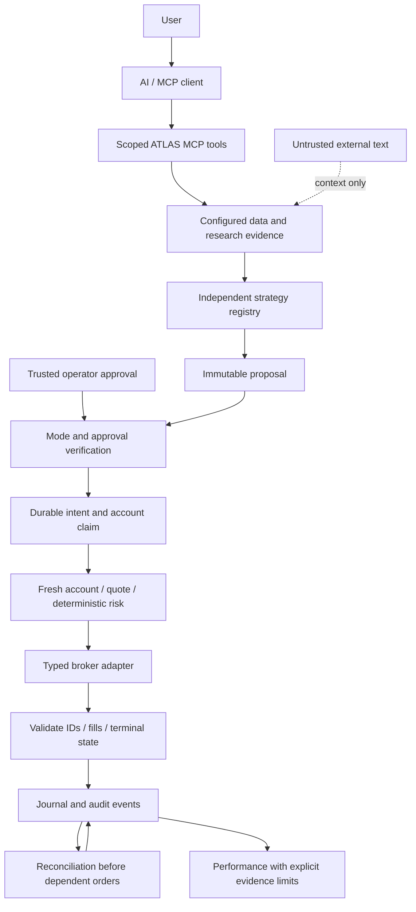

# ATLAS implementation and audit report

Development date: September 9, 2026. Scope: local source changes and offline verification in `/Users/leon/Desktop/dev/ATLAS`. No deployment, persistent service, broker authentication, account read, funded order or GitHub push occurred. See the final verification section for exact results.

## Before this change

ATLAS was primarily a short-horizon FX-binary research toolkit: DuckDB candle storage, pandas features, LightGBM/calibration research, registered forward evaluation, optional unofficial IQ Option access, JSONL observations and a legacy SQLite journal. Earlier engineering work added portable state paths, explicit execution modes, shutdown handling and durable unknown-submission markers.

The lifecycle remained spread across several root scripts. `collector.py` and related collectors acquired candles; `features.py` and pooled research assembled features/labels; `train.py` fitted and calibrated chronological models; runners selected model files and decisions; `live_h2_runner.py`, `run_once.py` and old `server.py` contained distinct broker-call paths. Settlements, signals and journals were not one immutable proposal/approval state machine. `execution_guard.py` described a sole gateway but was not actually the shared executor. Its numeric amount check also accepted NaN.

The audit included the runner/supervisor, collectors, broker wrapper, mode selection, storage, validation, feature/training/model loading, research families, journal/reconciliation, operational paths, backups, health/self-checks, CLI and tests. Inventory used tracked files as well as filesystem state because ignored model pickles and `journal.db` remain tracked. Model bytes were hashed, not unpickled. No frozen evaluator, real dataset training or model replacement ran.

Key coupling and evidence problems:

- The H2/H3/H4 contracts are FX-binary-specific, including payout, horizon and snapped expiry. Their probabilities cannot be reused as equity or spot-crypto predictions.
- Historical model selection used matching filenames; current source did not establish an approved production artifact/data contract.
- Known accepted orders and unknown submissions had different legacy recovery paths, without a shared portfolio/account-level journal claim across MCP and runners.
- Broad legacy MCP broker mutation helpers could bypass a proposal/human-approval flow.
- Model/research evidence included label-availability leakage, future volume-dependent feature availability, repeated holdout selection and small correlated execution samples.
- Root health/self-checks and historical host scripts were too broad to expose as a lightweight AI-facing readiness probe.

## What changed and why

| Problem | Implementation | Verification and remaining limit |
|---|---|---|
| Several independent execution paths | `AtlasService` coordinates immutable proposals, fresh server evidence, risk, durable intent, acknowledgement and reconciliation; legacy REAL CLIs and old MCP mutation registrations quarantined | Fake integration tests prove no old public bypass; private legacy Python internals are retained, not a security boundary against arbitrary host code |
| AI could become an accidental source of trading numbers | Bounded tools read configured datasets; registry exposes separate causal baseline signals; external text remains attributed data | Injection-shaped input cannot change policy, evidence provenance or approvals; no calibrated live provider is shipped |
| Generic conversational approval is ambiguous | Exact full-proposal digest, nonce, expiry, HMAC receipt and separate operator CLI | Forgery, tampering, expiry, replay and changed-policy/account/currency/evidence cases tested; shared-key trust is not hardware-backed human identity |
| Retry after uncertainty could duplicate orders | SQLite durable claims/client UUIDs, account pending block, idempotent replay, explicit reconciliation | Crash, timeout, unknown response, restart, write failure, concurrent claims and stale reconciliation tested; broker idempotency retention remains unverified |
| Cancellation can race fills | Separate cancellation proposal/approval, durable child intent and atomic target resolution | Wrong IDs, queued acceptance, partial fills, cancellation timeouts and concurrent stale responses tested |
| Damaged paper state could reset money | Persistent simulator with exact schema/data validation, consistent snapshots and durable commit checks | Damaged/empty state refuses; fees, cost basis, cash, reserve, restart and failure injection tested; fill realism remains intentionally simple |
| Future data changed prior features | Explicit feature v2 removes whole-series volume-availability dependence; pooled context built before future-label filtering | Synthetic counterexamples now require prefix equality; default v1.3.0 and frozen artifacts are preserved |
| Weak temporal contracts and unsupported metrics | Chronology/gap checks, matched cost-aware baseline comparison and explicit metric availability | Synthetic chronology/cost/calibration/sample-limit tests; no market-data edge comparison reproduced |
| Unclear account/API support | Separate official Crypto REST contract adapter and Agentic MCP schema boundary, broker capabilities | Strict fake transports only; real network factory unavailable |
| Development and production settings mixed | Explicit external configuration, scope-separated state, owner-only secrets, authenticated loopback HTTP and inert Linux examples | In-process ASGI/config/signal-handler tests; no listener or Linux deployment tested |

## Robinhood findings

**Official:** Robinhood publicly documents an Agentic Trading MCP service for equities, options and crypto at `https://agent.robinhood.com/mcp/trading`, with dedicated Agentic trading accounts. Public OAuth discovery advertises authorization-code/refresh grants and PKCE S256. A separate Crypto REST V2 specification supports account/holding/product/quote/order operations, Ed25519 request signing, client UUIDs, limit/market/stop types and documented rate limits. ATLAS implements only restricted limit-order mapping through an injected transport/signer.

**Unofficial/community:** Robinhood-named community wrappers are not the official hosted MCP. The older IQ Option integration uses an unofficial third-party library. No new reverse-engineered retail route, cookie authentication or community login dependency was introduced.

**Unsupported or uncertain:** Authenticated Agentic tool schemas, precise order/idempotency/rate semantics, this owner's eligibility/consent and production behavior remain unverified. No separate general retail equities/options REST specification was verified. Crypto REST lacks the complete verified risk input set required here; absent cash/equity/daily realized P&L/liquidity/session values remain unavailable. No public sandbox was established. Commercial multi-user legal/terms eligibility was not determined.

Primary sources: [Agentic overview](https://robinhood.com/us/en/support/articles/agentic-trading-overview/), [official tool catalog](https://robinhood.com/us/en/support/articles/trading-with-your-agent/), [OAuth discovery](https://agent.robinhood.com/.well-known/oauth-authorization-server), [Crypto reference](https://docs.robinhood.com/crypto/trading/), [Crypto API help](https://robinhood.com/us/en/support/articles/crypto-api/), [third-party policy](https://robinhood.com/us/en/support/articles/third-party-connections/). Exact findings, dates, schemas and caveats are in [robinhood-research.md](robinhood-research.md).

## New architecture



The broker protocol covers account snapshots, quotes, open orders, submit, cancel and status. Positions/cash are components of the account snapshot. Capabilities identify supported asset classes/account modes/order types and missing guarantees. The core never imports a Robinhood client. A future authenticated transport/provider is a separate component.

## MCP capability catalog

Every implemented tool is listed below. Capability counts are registrations, not a claim that unavailable account/model data exists. Default research has **21 tools**. Non-research adds **four** proposal/reconciliation tools. Explicitly permitted execution registration adds **two**, for a maximum of **27**. No tool approves proposals or proxies arbitrary broker calls.

| Tool | Purpose |
|---|---|
| `atlas_get_account_summary` | Sanitized verified snapshot, or structured unavailable |
| `atlas_get_positions` | Positions with unknown valuations preserved |
| `atlas_get_cash` | Cash, buying power, currency and observation time |
| `atlas_get_market_quote` | Quantity/side-specific quote |
| `atlas_get_market_context` | Configured deterministic context and provenance |
| `atlas_get_signals` | Independent server-produced signals |
| `atlas_get_model_predictions` | Recorded historical FX-binary observations only |
| `atlas_get_recent_research` | Bounded allowlisted historical research |
| `atlas_get_trade_history` | Selected-scope durable intents; bounded history |
| `atlas_get_portfolio_risk` | Account exposure, policy, pending/day/kill state |
| `atlas_explain_signal` | Signal evidence, reasons and invalidation rules |
| `atlas_get_strategies` | Available versions, enablement and validation status |
| `atlas_get_performance` | Descriptive operational metrics with unavailable inputs explicit |
| `atlas_analyze_symbol` | Analyze server-owned bars without caller-produced model numbers |
| `atlas_rank_opportunities` | Rank raw scores within each strategy; no arbitrary fusion |
| `atlas_run_scenario` | Explicitly hypothetical position-value change |
| `atlas_calculate_position_size` | Buy ceiling under available policy/account/liquidity inputs |
| `atlas_check_trade_risk` | Fresh risk report for an existing server signal |
| `atlas_simulate_order` | Risk math without persisting/submitting an order |
| `atlas_backtest_strategy` | One supported rule/control on configured bars with explicit costs |
| `atlas_compare_strategy_versions` | Compare compatible fixed v1.0.0/lookback-20 registry contracts; refuse unsupported versions |
| `atlas_create_trade_proposal` | Persist immutable proposed terms and evidence; non-research only |
| `atlas_get_trade_proposal` | Read exact terms and approval hash; non-research only |
| `atlas_create_cancellation_proposal` | Prepare cancellation of a known ATLAS-owned order; non-research only |
| `atlas_reconcile_order` | Read authoritative history for a known intent without retrying; non-research only |
| `atlas_execute_trade_proposal` | Only through service risk/mode/approval; explicit registration required |
| `atlas_cancel_order` | Execute a separately approved cancellation proposal; explicit registration required |

Seven read-only resources:

- `atlas://portfolio`
- `atlas://signals`
- `atlas://risk`
- `atlas://strategies`
- `atlas://performance`
- `atlas://models`
- `atlas://research/latest`

## Trading-engine and quantitative judgment

**Current evidence is insufficient to justify real-money trading.** Engineering improvements do not demonstrate better investment returns. No model probability, confidence, empirical hit rate or expected return is manufactured for NVDA or crypto.

| Evidence | Current judgment |
|---|---|
| Backtest | Historical selected results exist in notes; source data and exact replay artifacts are absent |
| Walk-forward | Chronological reported results exist, but original predictions/costs were not independently reproduced |
| Holdout | Related searches selected families/thresholds using holdout results; this is screening evidence |
| Paper candidates | Historical audit reported 259 signals but only 14 accepted orders; rejection was systematic by hour |
| Practice | Historical notes report 20 settled trades, 11 wins, +0.64 account units over a short clustered period |
| Funded live | No verified funded-live evidence available in this checkout |
| Confidence | No sufficient calibrated out-of-sample evidence for a funded deployment |
| Baseline comparison | No matched market-data evidence of superiority to buy-and-hold, random, momentum or mean reversion |

The two implementable registry rules are momentum and mean reversion. Their scores have defined price-distance units; they are not probabilities. Fixed baselines can be compared on the same causal next-open window with explicit fees/slippage and a reproducible random control. That capability was tested on synthetic data only. H2 directional probability and H3 conditional-correctness probability are different targets and are not blindly averaged. Learned weights/stacking/regime adjustments remain deferred until out-of-fold, time-aligned evidence exists.

Measurable correctness improvements include rejecting shuffled/duplicate chronology and inadequate label purges, preventing future observations from changing prior v2 feature rows, preserving signal identity across repeated reads, invalidating revoked evidence, maintaining acknowledged cumulative fills under concurrent reconciliation and refusing damaged persistent state. Test results establish those software properties, not a profitable edge.

[quantitative-audit.md](quantitative-audit.md) includes artifact hashes, 27 registry records/154 recorded variants, 24 separate experiment records, exact source-level methodological findings, evidence classes and a proposed validation design. Frozen models, `FORWARD_TEST.md`, `FINDINGS.md`, ledgers and the tracked legacy journal were preserved.

## Security review

Independent review exercised approval tampering/expiry, changed account/currency/policy/data, malformed IDs/fills, duplicate execution, ambiguous cancellation, crash after submission, write failures, damaged databases, secret-path permissions/symlinks, hostile research text and HTTP authorization. Defects found during review were fixed and covered by regressions. Financial inputs have explicit precision/magnitude bounds, and isolated decimal contexts prevent ambient rounding from weakening risk caps or changing paper bookkeeping. Secrets and raw account identifiers are excluded from the new public journal/tool schema. Historical model bytes are inventoried without execution.

Remaining limits: shared-key approval depends on trusted host/process separation; there is no public RBAC/OAuth issuer or remote TLS gateway; SQLite is not multi-host fencing; external account writes are outside ATLAS control; broker transport and production entitlement are unverified. Full threat model: [security.md](security.md).

## Verification

Final local verification on September 9, 2026:

| Check | Result |
|---|---|
| `uv sync --locked --group dev` | Passed; 78 packages resolved, 67 environment packages checked |
| `uv run --locked python -m pytest -q -ra` | **891 passed, 2 skipped in 51.30 seconds** |
| Skipped cases | Optional `iqoptionapi.constants` is absent; private-data smoke test requires explicit `ATLAS_TEST_DATASET` |
| Final precision/review/paper/risk/execution/Robinhood subset | **224 passed**; overlaps the full-suite count |
| MCP/config focused subset | **49 passed**; overlaps the full-suite count |
| Configured static checks | Pylint undefined/used-before-assignment checks passed, including every new `atlas/` Python module; no separate type checker configured |
| `python -m atlas demo` | Risk passed, one in-memory simulated fill, zero real orders; final synthetic cash `9897.999025` |
| `python demo.py` | **5 integrity checks passed** on **2,400 generated candles** |
| In-process MCP catalog verification | **21 / 25 / 27 tools** for research / paper / explicitly enabled paper execution; **7 resources**, zero listeners |
| Frozen artifact preservation | All **8** selected model/journal/protocol/research files matched prior HEAD byte-for-byte |
| `git diff --check` | Passed |
| Targeted secret-pattern scan | **54 changed files**, zero matches for selected private-key/token patterns; this is a bounded scan, not proof of absence of every possible secret |

The first full integration pass had 868 passing tests, two decimal string-format failures and two skips. Stable plain-integer output fixed those failures; the final pass includes the additional review regressions. Focused counts are not additive.

All tests used fake clients/transports, temporary state or synthetic data. No real brokerage execution, listener, authenticated account session, frozen evaluator or persistent service was part of verification. Actual server signal delivery, remote storage, live broker behavior and the prepared GitHub Actions workflow remain unverified.

The eight preservation checks covered `models/h2-20260722.pkl`, `models/h4-20260722.pkl`, `models/meta-h3.pkl`, `journal.db`, `FORWARD_TEST.md`, `FINDINGS.md`, `research_registry.jsonl` and `experiments.jsonl`. The exact model hashes are in the quantitative audit.

## Before deployment and funded trading

Research/paper deployment still needs a selected Linux host, reviewed service manager configuration, external data/config, authentication, resource/retention limits, consistent encrypted backups and a real host restore/shutdown drill. Example unit/config files are inert.

Funded operation additionally needs owner-controlled official brokerage consent/schema verification, a production transport and complete verified account/market provider, a calibrated pinned strategy provider, independent cost-aware validation, robust human authorization, single-writer coordination, reconciliation drills and concrete owner-approved account/limits/activation. Current live factory refuses; flags cannot bypass that block. See [server-readiness.md](server-readiness.md).

## Ranked next improvements

| Priority dimension | Rank 1 | Rank 2 | Rank 3 |
|---|---|---|---|
| Trading quality | Recover canonical data and matched actual costs, then test simple controls on fresh untouched observations | Pin and calibrate the correct product/target/horizon with nested chronological validation | Consider ensembles/regimes only if the same-time out-of-fold matrix proves incremental value |
| Reliability | Verify broker correlation, idempotency, fill history and single-host recovery under faults | Rehearse durable Linux state/backup restore and monitoring | Add event-driven market/account ingestion with as-of snapshots and complete valuation history |
| Security | Separate operator signing authority with asymmetric approvals and authenticated identity | Audit production broker OAuth/token storage, rotation and least-privilege ingress | Add independent tamper-evident audit export and multi-host fencing before scaling |
| GitHub appeal | Run the prepared CI on GitHub after an authorized push | Publish a reproducible licensed-data research recipe with candid baseline comparisons | Add a reviewed demo recording and contributor API examples grounded in the tested interface |

## Files and Git state

This batch changes **54 files** on `codex/atlas-offline-onboarding`. It is saved as one local commit titled `Build guarded ATLAS research and MCP platform`; no push or deployment is authorized. The final handoff reports the resulting commit hash and clean/dirty state. The earlier three local commits belong to preceding engineering work. A read-only remote check found `main` at `9800677ec1a5fa7a1c53e3e4e6b1554ea8085378` and no remote branch named `codex/atlas-offline-onboarding`; this task did not push.

Complete batch inventory:

```text
.github/workflows/ci.yml
README.md
atlas/__init__.py
atlas/__main__.py
atlas/analytics.py
atlas/approval.py
atlas/brokers/__init__.py
atlas/brokers/base.py
atlas/brokers/paper.py
atlas/brokers/robinhood_agentic.py
atlas/brokers/robinhood_crypto.py
atlas/config.py
atlas/domain.py
atlas/evidence.py
atlas/ledger.py
atlas/mcp_server.py
atlas/research_features.py
atlas/risk.py
atlas/service.py
atlas/strategies.py
atlas/validation.py
deploy/README.md
deploy/atlas.service.example
deploy/research-config.example.json
docs/platform-report.md
docs/quantitative-audit.md
docs/robinhood-research.md
docs/security.md
docs/server-readiness.md
execution_guard.py
execution_mode.py
features.py
live_h2_runner.py
pyproject.toml
server.py
supervisor.py
tests/test_atlas_quant.py
tests/test_bundles_payouts.py
tests/test_corrections.py
tests/test_forward_eval_guards.py
tests/test_legacy_quarantine.py
tests/test_platform_approval.py
tests/test_platform_config.py
tests/test_platform_execution.py
tests/test_platform_ledger.py
tests/test_platform_mcp.py
tests/test_platform_paper.py
tests/test_platform_review.py
tests/test_platform_risk.py
tests/test_robinhood_adapters.py
tests/test_runner_shutdown.py
tests/test_supervisor_resilience.py
tests/test_train.py
train.py
```
